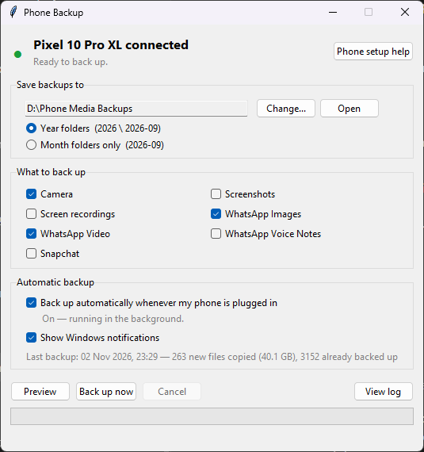

# phoneBackupOrganiser
Automatic, local backup of the photos & videos on your Android phone. Plug it into your PC and every new photo,
video and (optionally) screenshot or WhatsApp file is copied off and filed into tidy year/month folders.

A local copy alongside Google Photos / iCloud, with no cloud and no manual dragging and dropping.



## Features
- **Plug in and forget.** Runs quietly in the background from login and backs up whenever the phone is connected,
  with a Windows notification when it starts and finishes.
- **Organised by date.** Files go into `YYYY\YYYY-MM` folders (or flat `YYYY-MM`), dated from the filename
  (`PXL_20260319_...`, `IMG-20250101-WA0000`, ...) and falling back to the file's timestamp.
- **Only what's new.** A small database in the backup folder remembers what's been copied, so each plug-in only grabs
  new files and anything you tidy away on the PC isn't copied back.
- **Safe.** Copy-only: nothing on the phone is ever deleted. Files are size-checked, and an unplug mid-copy never
  leaves a half-written file.
- **You choose what to back up.** Camera, Screenshots, Screen recordings, WhatsApp images/video/voice notes, Snapchat.
- **Point-and-click control panel.** See if your phone is connected, change settings, preview, and back up on demand
  with a progress bar.

## Requirements
- Windows 10/11 and Python 3.10+ (no extra packages needed)
- [Android platform-tools](https://developer.android.com/tools/releases/platform-tools) (`adb`)
- An Android phone and a USB data cable

## Setup
**On your phone (one time):**
1. **Settings → About phone** and tap **Build number** 7 times to unlock Developer options.
2. **Settings → System → Developer options** and turn on **USB debugging**.
3. Plug the phone in, unlock it, and tap **Allow** (tick *Always allow from this computer*).

**On your PC (one time):**
```powershell
powershell -ExecutionPolicy Bypass -File install_startup.ps1 -Shortcuts
```
This adds **Phone Backup** to your Desktop and Start menu. Open it, pick where to save backups and what to include,
then tick **Back up automatically whenever my phone is plugged in**.

## Using it
Plug your phone in. That's it. You'll get a notification when the backup is done.

Open the **Phone Backup** window any time to:
- **Preview** what's new without copying anything,
- **Back up now** manually,
- see the **last backup** result, or click **View log** if something looks off.

Settings are saved to `config.json`, which you can also edit by hand.

### Command line (optional)
```
python phone_backup.py --dry-run   # show what would be copied
python phone_backup.py --once      # back up now
python phone_backup.py --watch     # run the background watcher
```
To stop automatic backup completely: `powershell -ExecutionPolicy Bypass -File install_startup.ps1 -Uninstall`

## Manual organiser (original tool)
`main.py` is the original Tkinter tool for sorting a folder of already-copied files into `YYYY-MM` folders:
1. Choose the folder to organise.
2. Choose the folder the organised files should be moved to.
3. Enter the year & month range.
4. Press sort.
